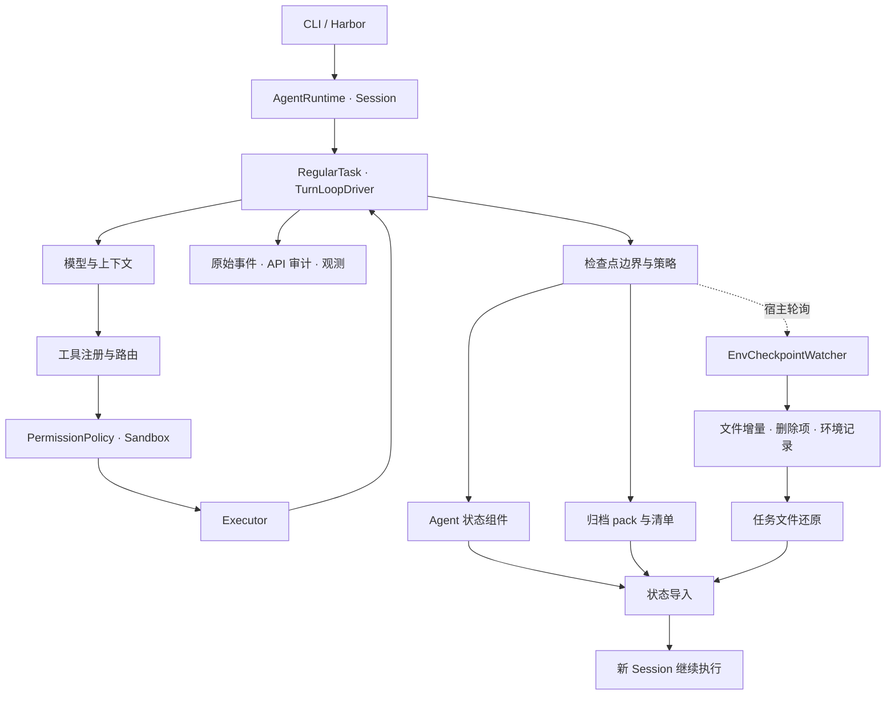

# Agent Checkpoint Core

一个以 **Agent 执行与检查点恢复**为核心的 Python 研究项目。它将模型—工具循环、上下文管理、执行权限和审计记录组合为运行时，并提供基于 **Agent 状态快照、共享归档 pack 和容器文件增量**的保存与续跑能力。

项目希望减少长任务的重复执行，并为 harness 改进与 RSI 实验提供可复用的中间起点：从同一份历史上下文和任务文件状态出发，比较不同版本后续执行的成本与表现。

> **当前状态：研究原型。** Agent 与检查点的离线保存、导入、续跑测试已通过；完整容器恢复仍有一致性和覆盖范围方面的限制。本文区分已实现接口与尚待完善的保证。

## 核心能力

- **Agent 运行时**：异步任务循环、结构化工具调用、追加输入、取消、预算管理和子 Agent。
- **模型接入**：OpenAI 兼容接口，支持 Chat Completions 与 Responses 协议。
- **工具与上下文**：文件、补丁、Shell、受管理进程、技能发现、完整观测和上下文压缩。
- **状态保存与导入**：保存对话、模型视图、计划、工具状态、预算、用量及原始事件；在新 Session 中重建继续执行所需状态。
- **归档与环境捕获**：共享 pack 保存归档对象，`docker diff` 配合文件元数据捕获环境变化，另行记录删除项和环境指纹。
- **审计与展示**：保留模型接口审计、结构化执行事件和本机只读轨迹展示能力。

## 架构



`checkpoint_plugin` 负责 Agent 状态契约、冻结和导入；`science_checkpoint` 负责保存策略、归档和环境捕获。两者共同服务当前实现，本仓库不包含旧 CAS 或 tree-linked 恢复路径。

## 快速开始

### 1. 准备环境

需要 Python **3.11+**。容器文件捕获和恢复还需要 Docker，以及与任务匹配的基础镜像。Harbor 集成需要调用环境提供 Harbor 和任务资源。

```bash
git clone https://github.com/Starlessnightx/agent-checkpoint-core.git
cd agent-checkpoint-core

python3 -m venv .venv
source .venv/bin/activate
python -m pip install pytest

# 不调用模型，检查配置和工具目录是否能加载
python main.py --inspect
```

命令从仓库根目录执行。这里直接运行源码，不要求通过 `pip install -e .` 安装项目。

### 2. 配置模型

通过环境变量注入凭据和模型配置，不要把密钥提交到仓库。

```bash
export MODEL_BASE_URL="https://your-provider.example/v1"
export MODEL_NAME="your-model"
export MODEL_API_MODE="responses"
export MODEL_THINKING="auto"
# 通过当前终端或凭据管理工具设置 MODEL_API_KEY
```

| 配置 | 用途 |
| --- | --- |
| `MODEL_API_KEY` | 模型服务凭据 |
| `MODEL_BASE_URL` | OpenAI 兼容 API 地址 |
| `MODEL_NAME` | 模型名称 |
| `MODEL_API_MODE` | `chat_completions` 或 `responses` |
| `MODEL_THINKING` | `auto` 时省略供应商特定的 thinking 扩展 |
| `HARNESS_WORKSPACE` | 任务工作区；默认是仓库下的 `workspace/` |
| `SCIENCE_CHECKPOINT_CONTROL_DIR` | 设置后启用 Agent 边界状态保存 |

### 3. 执行任务

```bash
export HARNESS_WORKSPACE="$PWD/workspace"
python main.py "检查工作区文件，说明项目结构"

# 需要终端交互时
python main.py --interactive "检查工作区并等待后续指令"
```

默认使用 `restricted` 权限模式。`container-benchmark` 和 `container-full-access` 是容器部署配置，要求受控 Linux 任务容器及 `HARNESS_EXECUTOR=contained`。其中全访问模式依赖外层容器隔离，不应在宿主环境直接使用。

## 检查点工作流程

### 保存：状态、归档与文件环境

```bash
export SCIENCE_CHECKPOINT_CONTROL_DIR="{workspace}/.checkpoints"
python main.py "你的任务"
```

这会启用 **Agent 状态与归档保存**。当前策略包含初始、结束、工具批次后的自动 `step` 保存，以及模型主动请求；存在未结束任务等情况时可能跳过保存。

**任务容器的文件环境需要宿主侧捕获。** `harness/task_runs.py` 集成 `EnvCheckpointWatcher`，调用 `science_checkpoint/env_delta.py` 记录文件变化。仅设置控制目录，不代表已经完成容器文件联合备份。

也可以手动捕获环境层：

```bash
python scripts/env_checkpoint.py capture \
  --container TASK_CONTAINER \
  --out /path/to/env-layer

# 后续捕获可指定前一层
python scripts/env_checkpoint.py capture \
  --container TASK_CONTAINER \
  --previous /path/to/env-layer \
  --out /path/to/next-env-layer
```

一次恢复所需的材料包括：**目标 Agent 状态、共享归档 pack、必要的环境层，以及匹配的基础镜像**。一个节点目录不能单独视为完整可迁移快照。

### 恢复：先还原文件，再导入状态

从已导出的任务归档创建恢复环境：

```bash
python scripts/restore_checkpoint.py \
  --archive /path/to/harness-checkpoints.tar.gz \
  --checkpoint CHECKPOINT_ID \
  --image TASK_IMAGE \
  --workspace /
```

该脚本创建容器、应用环境层和删除项，最后运行**状态导入验证**。它不会自动完成真实模型续跑。调试时可添加 `--keep` 保留创建的容器；默认收尾删除该容器。

在已经还原文件、重新注入模型凭据，且工作区和模型配置匹配的环境中，可继续原轮次：

```bash
python main.py \
  --resume /path/to/control/CHECKPOINT_ID \
  --resume-timeout 600
```

`--resume` 接收节点目录，并依赖其相邻的共享 pack。它负责状态导入与执行，不会代替宿主恢复文件环境。真实模型验证也可使用 `scripts/verify_real_continue.py`，参数见 `--help`。

### 数据布局

```text
control_root/
├── .archive-pack/
│   ├── objects.pack           # 共享归档对象
│   └── objects.index.json     # 对象定位索引
└── CHECKPOINT_ID/
    ├── request.json           # 边界、组件摘要和归档引用
    ├── components/            # 完整 Agent 状态组件
    ├── archives/              # 归档清单及普通文件日志
    └── env/                   # 宿主捕获后合入的环境材料
        ├── envdiff/
        ├── deletions.json
        ├── manifest.json
        └── environment.json
```

## 代码导航

| 路径 | 职责 |
| --- | --- |
| `main.py` | CLI 启动、模型配置、普通运行与恢复入口 |
| `harness/core/`、`harness/tasks/` | Session、输入提交、采样与工具循环、预算和取消 |
| `harness/model.py`、`harness/context/` | 模型 API、协议转换、上下文与观测管理 |
| `harness/tools/`、`harness/skills/` | 工具实现、参数声明和按需加载的技能资源 |
| `harness/executor/`、`harness/permissions/` | 文件与进程操作、权限判定和 Sandbox |
| `harness/trusted/`、`safety/` | 可信部署配置、公共路径保护和审计支持 |
| `harness/subagents/` | 子 Agent 启动、管理和已完成结果恢复 |
| `harness/task_runs.py`、`harness/env_watch.py` | 宿主任务编排与环境捕获 |
| `science_checkpoint/` | 保存策略、安全边界接入、pack 和环境增量 |
| `checkpoint_plugin/` | 状态契约、冻结、导入和模型兼容校验 |
| `harbor_agent.py`、`harbor_capture.py` | Harbor 部署适配和产物收集 |
| `scripts/`、`tests/` | 捕获/恢复工具、续跑验证与离线回归测试 |

阅读主循环可从 `main.py → harness/core/runtime.py → harness/core/submission.py → harness/tasks/regular.py → harness/core/turn.py` 开始。

技能目录中的 `SKILL.md`、`references/` 和 `prompts/` 是运行时资源，需要与源码一起保留。

## 测试与验证范围

```bash
python -m pytest tests -q
```

最近一次该测试集结果为 **111 passed，5 subtests passed**。其中包含真实 Runtime 配合脚本模型的 pack 保存、状态导入、同节点两次新 Session 续跑，以及旧工具不重放检查。

| 验证层次 | 说明 |
| --- | --- |
| 入口加载 | `main.py --inspect` 及恢复、真实续跑脚本的 CLI 可加载 |
| 离线保存与续跑 | 使用脚本模型验证，不依赖付费 API |
| 精简版真实模型与 Docker 联合恢复 | 尚未重新完成全面验收 |
| 最终任务效果 | 应由原 verifier 独立评分，不以状态导入成功代替任务成功 |

额外运行技能自带测试时，使用 `--import-mode=importlib` 避免同名测试模块冲突。目前 `project-testing` 技能有一条既有的工具列表断言未覆盖新增 Git 工具；不影响上述 `tests/` 测试集结果。

## 已知限制

- **联合保存一致性**：宿主异步捕获文件与 Agent 状态冻结之间，仍需加强一致的等待、捕获与确认协议。
- **环境覆盖**：当前文件捕获以容器可写层为主；volume、bind mount 和外部服务需要额外定义支持范围。
- **增量依赖**：基础镜像身份、父节点链和分支隔离仍需完善，恢复时必须提供正确的依赖材料。
- **完整性与资源限制**：pack 对象校验、中断恢复、配额及大归档内存使用仍有改进空间。
- **恢复范围**：不保存运行进程的内存、活动网络连接或外部服务状态；不支持旧 CAS / tree-linked 检查点。

这些限制意味着当前实现适合继续研究与受控验证，尚不能承诺任意节点、任意任务环境的可靠完整恢复。
